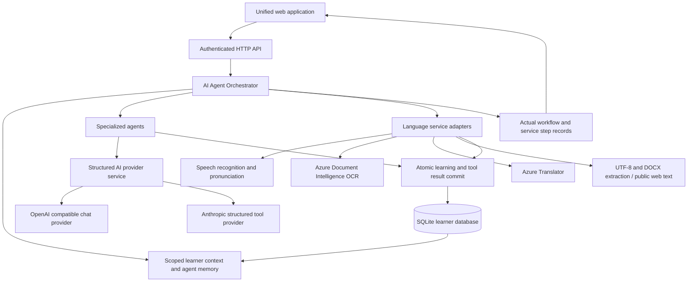

# Language ecosystem architecture

The application keeps learning and language tools inside one authenticated workspace. Fourteen specialized agents operate through `AgentOrchestrator`: the twelve roles in the product vision plus a Content Agent and the original Speaking Agent for audio performance feedback. Language tools delegate through the same execution engine as learning activities.

## Integrated speech-to-learning example

1. The learner selects Kannada as the source and English as the target, records a phrase, and enables “Help me learn from this result.”
2. The server validates the real WAV and sends it to the configured speech-recognition adapter with `kn-IN`. An unsupported locale produces a clear provider error.
3. The Translation Agent translates the actual transcript. When Azure Translator is selected, the agent explains the actual service translation; a changed translation is rejected.
4. Cultural Context and Voice and Conversation Agents explain usage and a useful conversational response.
5. Pronunciation Coach, Grammar, and Vocabulary Agents use the translated English material. Phonetic guidance is explicitly an AI estimate. Audio pronunciation scores are supplied only by supported Azure pronunciation assessment.
6. The Content Agent generates a real quiz from the vocabulary and grammar. Answer keys stay server-side. Learning Path and Progress Analysis Agents recommend how to practice it.
7. The English profile, agent memories, useful words, generated activity, tool result, and updated plan commit together. The currently selected learning language is not changed by translating.
8. The learner can open the saved English practice, listen with an installed device voice, and generate a read-aloud activity for actual audio pronunciation measurement when the locale is supported.

Source audio is not persisted. The recognized transcript, extracted source text, translated result, and learning evidence are persisted in that user's account. Uploaded source files are not written to disk by the extraction tools.

## Ownership and persistence

`profiles` stores the active language for compatibility with the original application. `language_profiles` stores the separate level, goal, native language, daily minutes, locale, dialect preference, teaching style, and focus of every enrolled language. Version 2 migrates the existing active profile without deleting existing learning records.

Agent memory, messages, vocabulary, activities, attempts, plans, insights, and runs are scoped to both user and language. Tool history is scoped to the authenticated user. Two-person translation sessions have an explicit owner and two language directions; each turn is validated against its speaker and session before a billable agent call. Universal search returns only the authenticated user's saved content.

Tool use does not count as a completed learning assessment. Generating a quiz does not complete it. New language enrollment from a tool happens only after its complete learning workflow succeeds. Failed workflows keep an audit trace and apply no partial learning changes. The browser clears private tool results and drafts on logout or expired authentication.

## Service boundaries

LLM translation, dictionary, detection, transliteration, grammar, writing, summarization, cultural explanations, and pronunciation guidance use actual structured model requests. Their quality and coverage depend on the selected model. The catalog is a set of language choices, not an accuracy guarantee.

Azure Translator optionally provides actual translations, detection scores, and transliteration. Its supported translation languages are checked against its live capabilities endpoint. Azure Document Intelligence extracts images and PDFs through the asynchronous `prebuilt-read` API. DOCX extraction reads the bounded `word/document.xml` ZIP entry without extracting files or resolving XML entities. TXT, Markdown, CSV, and HTML use local UTF-8 parsing.

Website translation fetches public HTTPS text only. It rejects private, loopback, metadata, mapped IPv6 and internal hosts, pins the validated DNS address, revalidates each redirect, limits response size, and does not execute website scripts. Credentialed, dynamic, and inaccessible pages need pasted content.

Device text-to-speech is a native browser capability. It does not pretend to invoke an AI agent or synthesize downloadable AI audio. The selected language needs an installed voice. Conversation translation is turn-based with short recordings; continuous simultaneous interpretation is not implemented.

## Implemented phases

| Phase | Delivered |
| --- | --- |
| 1: Shared foundation | Expanded language and script registry; per-language profiles; preferences; unified navigation; search; responsive themes |
| 2: Language tools | Seventeen tools; server AI requests; optional translation/OCR/speech adapters; local document parsing; public web text; owned conversation sessions |
| 3: Connected learning | Translation-to-learning pipeline; saved vocabulary and quizzes; pronunciation guidance; adaptive plans; cultural, exam, travel, and professional practice |
| 4: Verification | Tool and service contracts; real HTTP auth/profile/search checks; file and network boundary tests; atomic failures; browser navigation, themes, forms, profiles, and configuration gating |

Tests use named test providers, fixture text, and synthetic audio; no test adapter is selectable in production. Live model quality, paid provider connectivity, microphone hardware, camera hardware, installed device voices, and each provider's language coverage require external configuration and actual device testing.

The deployment remains one Node process with SQLite. Distributed queues, multi-instance storage, full document layout reconstruction, continuous interpretation, and official exam certification are future work. The repository, agent definitions, and service adapters provide the boundaries for adding those capabilities without disconnected chatbots.
